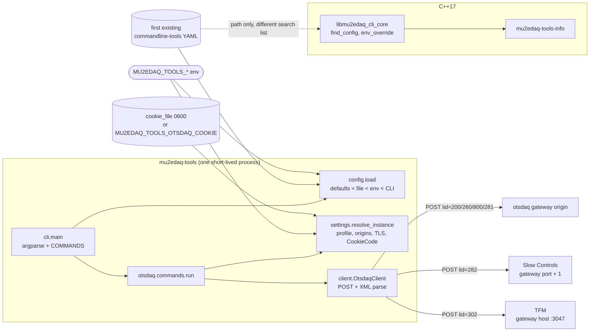

# mu2edaq-commandline-tools

> Single `mu2edaq-tools` dispatcher with one YAML config and a command line >
> environment > file > defaults rule, whose only real subcommand is an otsdaq
> xdaq HTTP client (typed getter reads plus an unrestricted `raw` request),
> alongside a C++17 library that locates the same config file but does not
> parse it.

| | |
|---|---|
| Repository | `Mu2e/mu2edaq-commandline-tools` (public, issues enabled, 0 issues on 2026-10-06) |
| Language | Python 3.9+ (dispatcher, otsdaq client), C++17 (`mu2edaq_cli_core`, `mu2edaq-tools-info`) |
| Version | 0.2.0 (`src/mu2edaq_commandline_tools/__init__.py:3`; CMake parses it, `CMakeLists.txt:3-9`) |
| Ports | binds none; connects to an otsdaq gateway origin (example `https://localhost:3075`), Slow Controls at gateway port + 1, TFM at gateway host port 3047 |
| Depends on | otsdaq xdaq HTTP endpoints (run by the `otsdaq-mu2e*` configurations); PyYAML, requests |
| Tests | 51 pytest cases and 5 CppUnit checks, all passing on Python 3.12 and 3.9.6 in this review; no CI |

Companion documents: [INTERFACES.md](INTERFACES.md) (command line, config
resolution and the Python/C++ comparison, otsdaq wire protocol, authentication),
[ISSUES-PENDING.md](ISSUES-PENDING.md) (staged findings), the pre-existing
[otsdaq Phase 1 HOWTO](otsdaq-phase1-howto.md) and
[command-surface survey](otsdaq-command-surface.md). There is no daemon, so there
is no OPERATIONS.md.

## Purpose

A home for short-lived shell tools that share one dispatcher, one config file
and one precedence rule (`README.md:5-9`). As of `21420c9` (2026-09-17) the only
subcommand that does anything beyond reporting its own configuration is
`otsdaq`: a synchronous client for the xdaq HTTP endpoints of a running otsdaq
instance, modelled on the CRV web client
`otsdaq-mu2e-crv/UserWebGUI/js/mu2e.js:21-67`. It reads run-control state, run
info, artdaq report/state, the live FE-macro list, Slow Controls PVs and alarms,
and console/system messages, and it exposes an expert `raw` request that is not
read-only.

The five global settings (`cluster`, `discovery_timeout`, `log_level`,
`log_dir`, `color`; `config.py:51-58`) are parsed, resolved and shown by
`mu2edaq-tools config`, but no subcommand reads them: the package configures no
logging, performs no discovery and prints no colour (CLT-012).

## Architecture



## Components

### Dispatcher (`src/mu2edaq_commandline_tools/cli.py`)

`COMMANDS` (`cli.py:73-82`) maps a name to `Command(help, add_arguments, run)`:
`list`, `config`, `version`, `otsdaq`. `build_parser()` (`:88-124`) adds the
global options, which must precede the subcommand, and one subparser per entry.
`main()` (`:127-148`) returns 2 with no subcommand, calls `config.load()` with
the global options as overrides, catches `OSError`, `ValueError` and
`RuntimeError` as exit 1, and hands `(args, cfg)` to the subcommand. A YAML
syntax error (`yaml.YAMLError`) is not caught and exits 1 with a traceback
(CLT-011).

### Config resolution (`src/mu2edaq_commandline_tools/config.py`)

`load()` (`:196-223`) deep-copies `DEFAULTS`, applies the first existing file
from `config_search_paths()` (`:120-132`), then `MU2EDAQ_TOOLS_*` from the
environment (`load_env`, `:172-193`), then non-`None` command-line overrides.
Empty environment values count as unset (`:180`, `:185`). The `otsdaq` block is
merged key by key through `_merge_otsdaq` (`:92-117`), which coerces `timeout`
to float and `verify_tls` to bool. There is no `.env` layer (CLT-013). The
file and environment layers are covered by `tests/test_config.py`.

### otsdaq connection settings (`src/mu2edaq_commandline_tools/otsdaq/settings.py`)

`resolve_instance()` (`:98-220`) picks the profile (`--instance`, else
`MU2EDAQ_TOOLS_OTSDAQ_INSTANCE`, else `otsdaq.default_instance`; `:119-123`), or
accepts an anonymous `<override>` when a gateway URL is supplied (`:131-140`).
It then merges top-level `otsdaq` keys < profile < environment < keyword
arguments (`:144-179`), validates every origin as `http`/`https` with no path,
query, fragment or credentials (`_origin`, `:40-55`), and derives Slow Controls
as gateway port + 1 (`:67-74`) and TFM as gateway host port 3047 (`:183`). A CA
bundle from any layer forces verification on (`:200-206`), even over
`--insecure`. The CookieCode comes from `MU2EDAQ_TOOLS_OTSDAQ_COOKIE`, else from
`cookie_file`, which must have no group or other permission bits on POSIX
(`_read_cookie`, `:77-95`).

The TFM rule is the CRV web client's constant (`mu2e.js:9`,
`const TFM_PORT = 3047`). Every profile without an explicit `tfm_url` on the
same host, or tunnelled to `localhost`, resolves the same TFM (CLT-001).

### otsdaq HTTP client (`src/mu2edaq_commandline_tools/otsdaq/client.py`)

`OtsdaqClient.request()` (`:98-168`) builds
`<origin>/urn:xdaq-application:lid=<LID>/Request?RequestType=<name>` (or
`/StateMachineXgiHandler?StateMachine=<name>`), sends an HTTP **POST** with a
form body (`:131-137`), requires a 2xx status and an XML `<ROOT>`, and raises on
any `Error`/`ERROR` element, `state_transition_attempted=0`, or a non-empty
`Error`/`error`/`ErrorMessage`/`error_message` field in `DATA` (`:170-186`). It
adds `CookieCode` to the form only when the LID is 281 (`:124-125`). Typed reads
(`:188-272`) wrap getter RequestTypes; `macro_list()` (`:217-235`) parses the
`FEMacros` value as `:`-separated with no tooltip field (`:290-330`), which
disagrees with the newer otsdaq-mu2e web client (CLT-006).

### otsdaq subcommand (`src/mu2edaq_commandline_tools/otsdaq/commands.py`)

`add_arguments()` (`:34-92`) builds 12 typed read commands and `raw`. `run()`
(`:115-143`) resolves the instance, prints the TLS warning to stderr whenever
verification is off (`:131-136`), and dispatches. `_run_typed()` (`:146-183`)
implements `--json` envelopes, `--watch`/`--interval`/`--count`, and exit 130
on Ctrl-C. `_run_raw()` (`:227-253`) warns on stderr and sends any RequestType
to any LID with any handler, query and form (CLT-007).

### C++ library and diagnostic (`src/cpp/`, `src/include/`)

`mu2edaq_cli_core` (`mu2edaq_cli_core.cpp:36-78`) returns the candidate config
paths, the first existing one, and a single `MU2EDAQ_TOOLS_<KEY>` value with a
caller-supplied fallback. It has no YAML parser, no defaults and no
command-line layer. Its search list omits the Python package's own
`config/` entry and does no `~` expansion, so the two languages can choose
different files from the same directory (CLT-004). `mu2edaq-tools-info`
(`mu2edaq_tools_info.cpp:30-69`) prints the version and the chosen path.

### Scripts

`bootstrap.sh` creates `venv/` and an editable install, and with `--cpp` runs
CMake into `build/`. `start-mu2edaq-commandline-tools.sh` refreshes the venv,
writes a pidfile and `exec`s the dispatcher; the `exec` discards its EXIT trap,
so the pidfile is never removed (CLT-005). `stop-mu2edaq-commandline-tools.sh`
signals the pidfile's PID, deletes `__pycache__`, and `rm -rf`s the directory
named by `MU2EDAQ_TOOLS_LOG_DIR` (CLT-002).

### Maintenance tool and documentation site

`tools/extract-femacros.py` scans `registerFEMacroFunction(` call sites in the
sibling `otsdaq-mu2e*` checkouts and writes `data/otsdaq-femacros.json`, the
static inventory behind `doc/otsdaq-command-surface.md`. `html/` is a static
walkthrough of the Phase 1 HOWTO; `html/validate.py` checks its links and
structure.

## Interfaces

Summarised here; [INTERFACES.md](INTERFACES.md) has the detail.

- **Command line:** `mu2edaq-tools [global] {list,config,version,otsdaq}`; 12
  typed `otsdaq` reads and `otsdaq raw`. Exit 0/1/2/130.
- **Outbound HTTP:** POST to xdaq LIDs 200, 260, 281, 800 (gateway origin), 282
  (Slow Controls), 302 (TFM). No inbound port.
- **Python API:** `config.load`, `otsdaq.resolve_instance`, `OtsdaqClient`.
- **C++ API:** `mu2edaq::cli::{version, env_prefix, config_search_paths,
  find_config, env_override}`.

## Configuration

One YAML file, first existing of:

| Order | Path | Python | C++ |
|---|---|---|---|
| 0 | `-c FILE` (then the only candidate) | yes, `~` expanded | `mu2edaq-tools-info -c` only, literal |
| 1 | `$MU2EDAQ_TOOLS_CONFIG` | yes, `~` expanded | yes, literal |
| 2 | `./mu2edaq-commandline-tools.yaml` | yes | yes |
| 3 | `./config/mu2edaq-commandline-tools.yaml` | yes | yes |
| 4 | `<package>/config/mu2edaq-commandline-tools.yaml` | yes (`config.py:130`) | **no** |
| 5 | `~/.config/mu2edaq/commandline-tools.yaml` | yes | yes |
| 6 | `/etc/mu2edaq/commandline-tools.yaml` | yes | yes |

`<package>` is `Path(config.py).parents[2]`. Under the editable install that
`bootstrap.sh:66-68` creates, that is the checkout, whose tracked
`config/mu2edaq-commandline-tools.yaml` always exists, so the Python tools never
reach entries 5 and 6. `cmake --install` writes the reference file to
`${prefix}/etc/mu2edaq/commandline-tools.yaml` (`CMakeLists.txt:94-96`), on
neither list unless the prefix is `/` (CLT-014).

The tracked reference file (`config/mu2edaq-commandline-tools.yaml`) sets
`otsdaq.verify_tls: false` (`:35`) and has no instance defined. The default
`verify_tls` is also `False` in code (`config.py:42`). Every otsdaq command
therefore runs with certificate verification off unless an operator enables it,
and says so on stderr (CLT-003).

Copies of the same YAML ship in `mu2edaq-config` under
`config-*/mu2edaq-commandline-tools/`; that layout is not on either search list
(`mu2edaq-config/docs/INTERFACES.md:103-109`, CFG-005).

## Operations

There is no service. Each invocation is one process that exits when its read
completes, or on Ctrl-C under `--watch`. Typical use:

```bash
./bootstrap.sh --dev --cpp && source venv/bin/activate
mu2edaq-tools config                       # which file, which values
mu2edaq-tools otsdaq state --instance crv  # needs otsdaq.instances.crv
mu2edaq-tools otsdaq daq-state --watch --count 5 --json
build/mu2edaq-tools-info --paths           # which file the C++ side would pick
```

`start-…`/`stop-…` exist for suite uniformity. For a one-shot tool the stop
script's only effects are signalling whatever process holds the stale PID and
deleting the log directory and `__pycache__`.

## Interactions with other packages

| Package | Relation | Evidence |
|---|---|---|
| otsdaq (`otsdaq-mu2e*` configurations) | HTTP POST client of the gateway, Console, Macro Maker, Configuration, Slow Controls and TFM supervisors | `otsdaq/client.py:131` |
| `otsdaq-mu2e-crv` | source of the transport model, the LIDs, Slow Controls = port + 1 and TFM = 3047 | `doc/otsdaq-command-surface.md:122-148`; `mu2e.js:9,27-67` |
| `otsdaq-mu2e*` sources | read by `tools/extract-femacros.py` (filesystem, maintenance only) | `tools/extract-femacros.py:24,116` |
| `mu2edaq-CFOControl` | independent client of the same Macro Maker over UDP; parses `FEMacros` on `;` with a tooltip field | `mu2edaq-CFOControl/docs/INTERFACES.md` §2.1 |
| `mu2edaq-config` | ships copies of this package's YAML in a layout this package does not read | `mu2edaq-config/docs/INTERFACES.md:103-109` |
| `mu2edaq-discovery` | not used. `discovery_timeout` is configuration only; `requirements.txt:2-3` notes discovery is deliberately absent | `config.py:53` |
| `mu2edaq-operations` shifter docs | document the tunnel this client is meant to use; they disagree with its examples (CLT-008) | `mu2edaq-operations/shifter/docs/connecting.md:87-103` |

## Review findings

Staged in [ISSUES-PENDING.md](ISSUES-PENDING.md); none filed (CONTRACT §9.1).

| ID | Sev | Title |
|---|---|---|
| CLT-001 | S2 | [otsdaq] every profile derives the same TFM origin, so `daq-state` for one subsystem can silently read another's |
| CLT-002 | S2 | [lifecycle] the stop script `rm -rf`s whatever `MU2EDAQ_TOOLS_LOG_DIR` names, which is also the documented `log_dir` override |
| CLT-003 | S3 | [tls] certificate verification is off by default for every otsdaq request |
| CLT-004 | S3 | [config] Python and C++ choose different config files from the same directory, contrary to the package's stated premise |
| CLT-005 | S3 | [lifecycle] `exec` discards the EXIT trap, so the pidfile outlives every run and stop signals a recycled PID |
| CLT-006 | S3 | [otsdaq] `macros` parses `FEMacros` as colon-separated with no tooltip; the newer otsdaq-mu2e client parses semicolons with a tooltip |
| CLT-007 | S3 | [otsdaq] `raw` can drive state transitions, FE macros and configuration writes with no opt-in beyond a warning |
| CLT-008 | S3 | [docs] otsdaq examples disagree with the shifter tunnel on scheme, ports and forwarded services |
| CLT-009 | S3 | [ci] 51 pytest cases and 5 CppUnit checks with no CI workflow |
| CLT-010 | S4 | [auth] CookieCode hygiene: read on every command, kept in `InstanceConfig.repr`, owner unchecked, HOWTO puts it in shell history |
| CLT-011 | S4 | [config] a mistyped `-c` path is silently ignored and a YAML syntax error ends in a traceback |
| CLT-012 | S4 | [config] five global options are parsed, documented and shown but have no effect |
| CLT-013 | S4 | [config] no `.env` layer in the precedence chain |
| CLT-014 | S4 | [install] `cmake --install` writes the reference config to a path neither search list reads |

**TLS severity (CLT-003), S3 rather than the rubric's S2 anchor.** The anchor
assumes a client whose unverified connection carries credentials or control on
its default path. Here, no typed read attaches a credential (`client.py:124`
adds the CookieCode only for LID 281, which no typed read uses), so the default
path exposes only the integrity of read-only display data. The documented
deployment terminates TLS on `localhost` at an SSH local forward, so the
unverified hop is loopback plus the gateway-to-otsdaq leg inside the DAQ
network. The default is documented in the README, HOWTO, man page and config
comment, and every run prints a warning. The cases that would justify S2 are
opt-in: `raw --lid 281` with a configured CookieCode, or a direct (untunnelled)
gateway URL. They are recorded in the issue body.

**Read-only?** Every request is a POST, not a GET (`client.py:131`). The 12
typed commands send only getter RequestTypes, and none goes to LID 281, so none
carries a credential. Whether every getter is free of side effects is otsdaq
core behaviour, which this package does not contain and this review did not
verify. `raw` is not read-only.
